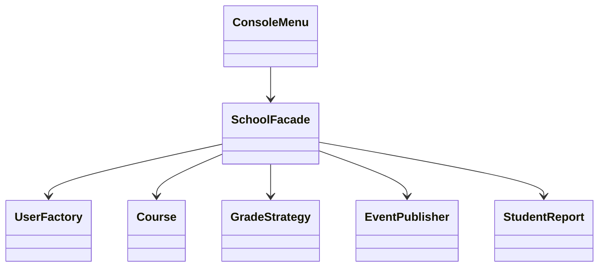
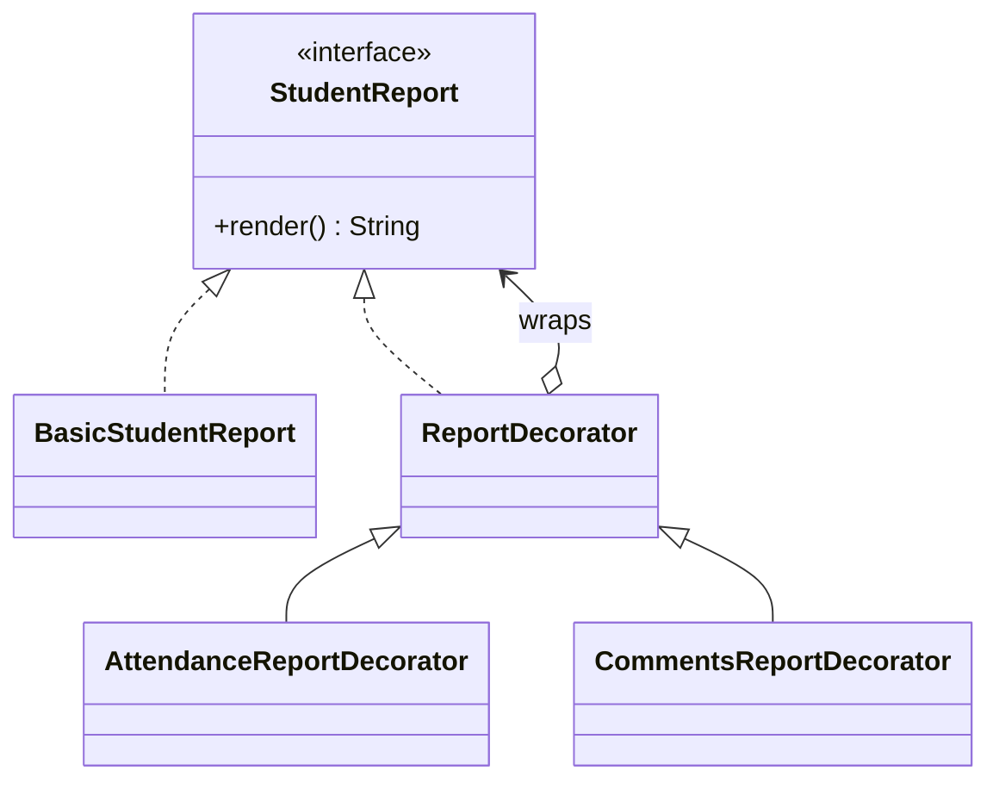

# Adil: Facade and Decorator

Owner: **adilzhandev**. Implementation: `application`, `reports`, console integration and local storage.

## Facade

`SchoolFacade` provides complete application operations: `addUser`, `addCourse`, `enroll`, `recordGrade`, `recordAttendance` and `generateReport`.
For `recordGrade` it verifies enrollment and category, checks the selected grading strategy, stores the assessment, and publishes one event. The console does not reproduce these business rules. Failed validation does not append a grade, notification or log entry.

## Decorator

`StudentReport` is the component interface (`render`). `BasicStudentReport` renders the student and course results. `ReportDecorator` holds another `StudentReport`.
`AttendanceReportDecorator` and `CommentsReportDecorator` add their own sections while preserving the wrapped report. Both can be selected, either can be selected, or the base report can be used alone.

## Defense demonstration

Run `java Run.java demo`, or use menu 13 in an empty school. Show S1's base report, then enable attendance, then comments, then both. C1 uses weighted categories (78%), C2 uses total points (80%).
Try enrolling a teacher as a student, enrolling S1 twice, or adding an unknown weighted category. Explain why the rejected operation leaves the data unchanged.

The PDF topic list suggests Decorator for roles/permissions as an example. This implementation deliberately uses composition of student reports instead; all six distinct patterns still participate in the same application scenario.

## Verification

`FacadeReportsTest`, `ConsoleTest`, `ConsolePersistenceTest`, `StorageTest` and `FileLockTest` exercise validation, both independent observers, report composition, persistence/restart, Unicode IDs, invalid console input, failed save recovery and exclusive file access.

The console is a single-operator teaching application. User roles model school participants; there is no password authentication. The local activity log and notifications are reconstructed from saved grades on startup.
