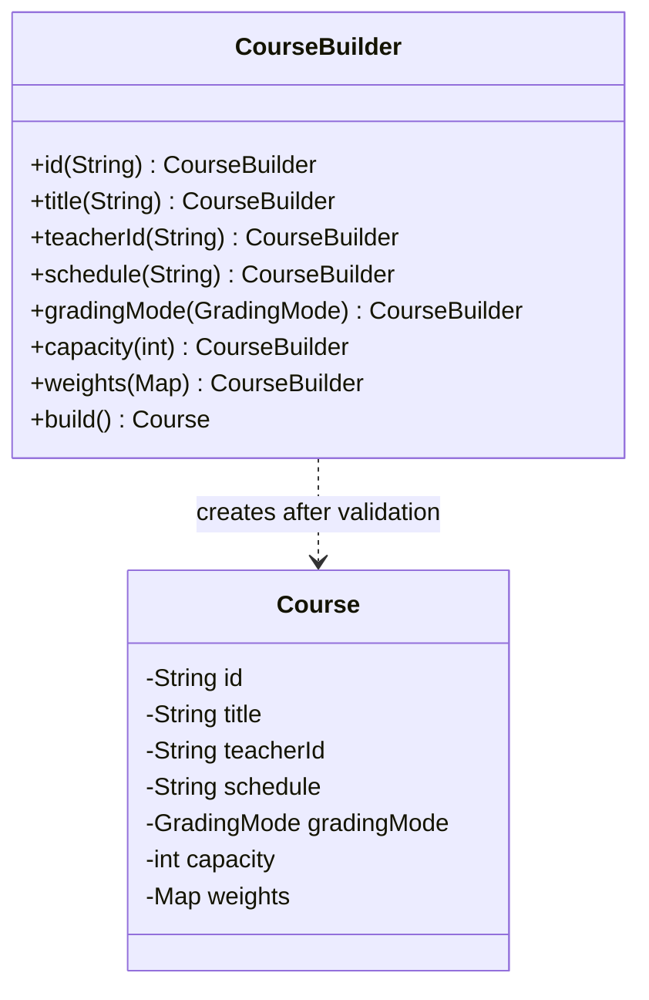
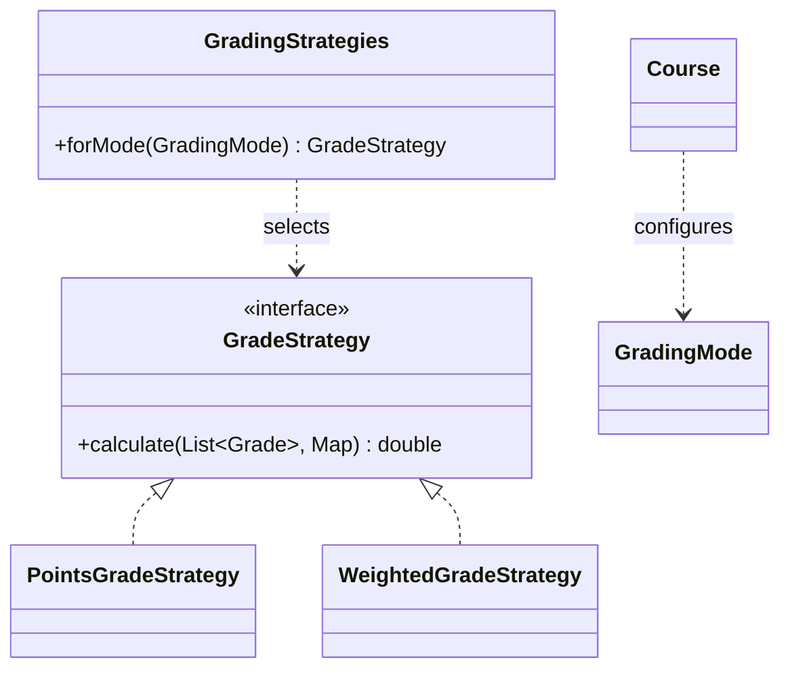

# Courses and grading - AsylStyle

This module implements **Builder** and **Strategy** using the Java standard library.
It contains no console input, database access, or framework code. The application
facade uses these classes while the console presents their results.

## Builder: a valid, immutable course

`CourseBuilder` collects the course ID, title, teacher ID, schedule, capacity,
grading mode, and category weights. `build()` checks the configuration and returns
an immutable `Course`. The caller can set optional fields in any order.

- ID, title, and teacher ID are required.
- The defaults are 30 places, `Not scheduled`, and `POINTS` grading.
- A weighted course needs positive finite category weights totaling 100%.
- Surrounding whitespace is removed from input text using `String.strip()`,
  including Unicode whitespace such as U+2003. Category names are also converted
  to lowercase using `Locale.ROOT`.
- Duplicate normalized categories, missing data, and invalid capacities are rejected.
- Input maps are copied and the course exposes an unmodifiable weight map.

The builder handles construction rules. The facade separately verifies that the
teacher exists and has the teacher role. Reusing the builder cannot modify an
already built course.

## Strategy: interchangeable grade calculation

`GradeStrategy` defines `calculate(grades, weights)`. Two implementations calculate
the same student's results with different rules. `GradingStrategies.forMode()`
selects the algorithm configured for the course; callers use the interface.

- **PointsGradeStrategy:** total earned points divided by total possible points,
  multiplied by 100.
- **WeightedGradeStrategy:** calculate the earned/possible ratio within each
  category and multiply it by that category's percentage.

For quiz **40/50** and exam **90/100**, points grading returns **86.67%**. With quiz
weight **40%** and exam weight **60%**, weighted grading returns **86.00%**.

Unassessed categories contribute **zero**. For example, a perfect quiz with weight
40% and no exam yet returns 40%, not 100%. This is the course result counting
unassessed categories as zero. Empty grade lists return zero, so the UI should
also show the number of assessments to distinguish no results from a scored zero.

Unknown weighted categories are rejected. Each calculation accepts grades for
one student in one course; the facade filters the stored grades accordingly.
The `Grade` record rejects nonfinite points, nonpositive maximum scores, and
earned scores outside the interval from zero to the maximum.

Totals use standard-library `BigDecimal` so adding large valid values does not
overflow to infinity. Weight sums allow a tolerance of 0.000001 percentage points;
within that tolerance the weighted result is normalized to a total of 100%.

## Demonstration and verification

1. Build a points-based course and a weighted course.
2. Show that a missing teacher ID or a weight total of 80% is rejected.
3. Enter the same quiz/exam results and compare 86.67% against 86.00%.
4. Show an unassessed category and explain its zero contribution.
5. Show that a score greater than the assessment maximum is rejected.

`tests/school/CoursesGradesTest.java` checks these behaviors, defensive copies,
builder reuse, empty results, normalized categories (including U+2003 whitespace),
invalid input, and large finite scores. Its `run()` method integrates with the project's dependency-free
test suite; its `main()` can also run the module tests directly.

**Responsibility:** AsylStyle owns course construction, grade calculation, and
the explanations and tests for these two patterns. The project is AI-assisted;
the assigned team member should review and understand this implementation before
presenting it.
