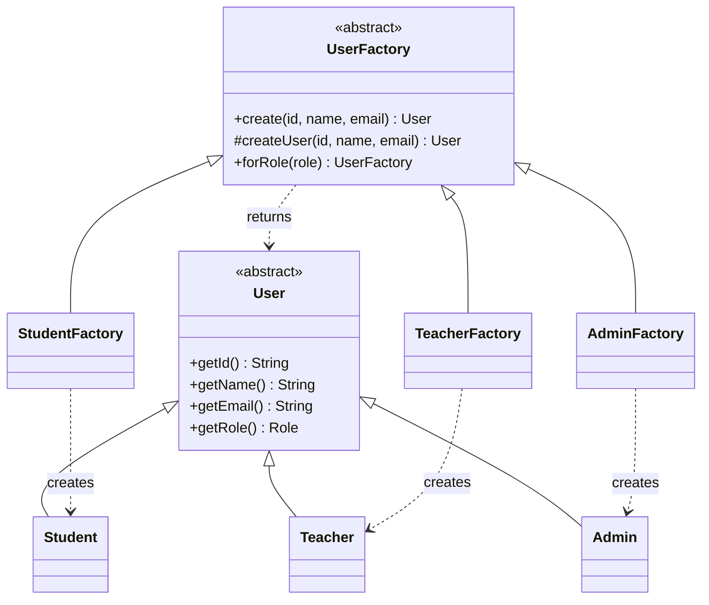
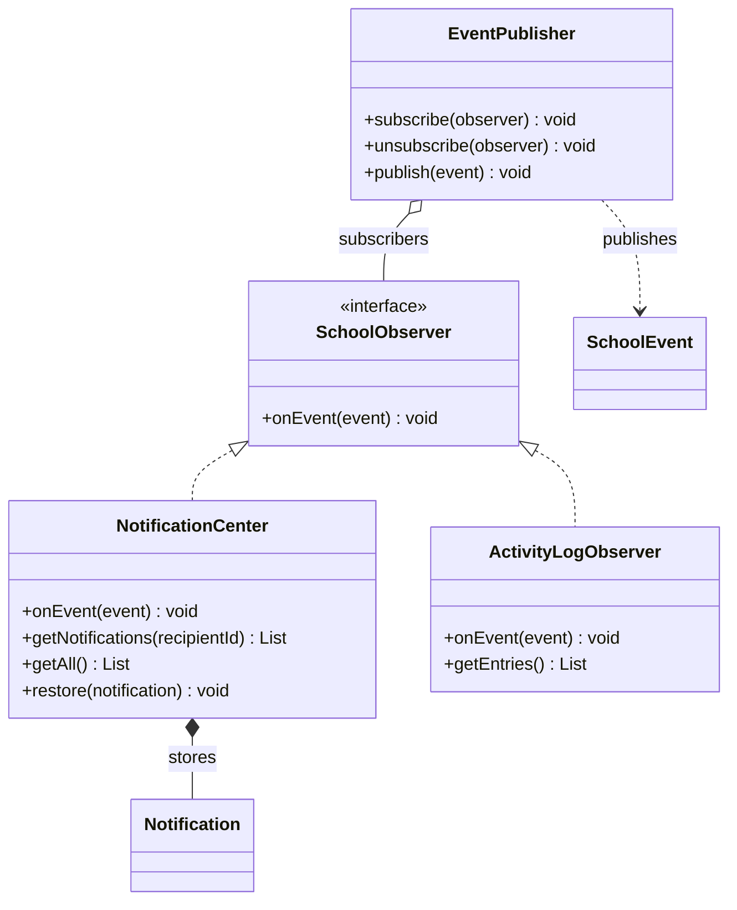

# Nurlan-byte: user creation and school notifications

Planned module owner: **Nurlan-byte**. This document describes the two design patterns assigned to this part of the School Management System: **Factory Method** and **Observer**. Ownership here identifies the agreed division of work; Git history records the actual commits.

## Factory Method

`User` is the immutable product abstraction. `Student`, `Teacher`, and `Admin` are concrete products exposing the same ID, name, email, and role getters. Their constructors validate the fields, and they have no setters.

`UserFactory` is the abstract creator. Its final `create(id, name, email)` operation validates and trims input, then invokes the protected abstract `createUser(...)` factory method. `StudentFactory`, `TeacherFactory`, and `AdminFactory` override that method to construct their own product.

`UserFactory.forRole(role)` selects a concrete creator. Its switch is only the creator-selection entry point: actual product construction remains in overridden factory methods. The design therefore demonstrates Factory Method rather than relying only on a switch returning different users.

Example: creating a student through `UserFactory.forRole(Role.STUDENT).create(...)` produces a `Student` with role `STUDENT`. The calling school workflow consumes the common `User` interface and does not need to construct the concrete class.

The email check is deliberately a basic address-format check for this demo; it does not verify mailbox existence. Invalid or missing fields raise `IllegalArgumentException`; a null factory role raises `NullPointerException`.

## Observer

`EventPublisher` maintains a set of `SchoolObserver` subscribers. An observer can subscribe or unsubscribe at runtime. Repeated subscription of the same observer does not duplicate delivery. Events are dispatched synchronously in subscription order to a snapshot of the subscribers, so subscription changes during a callback take effect on the next event.

`SchoolEvent` carries the affected student ID, teacher ID, course ID, and message. It contains no reference to UI components or concrete observers.

Two independent observers demonstrate different reactions to the same event:

- `NotificationCenter` creates a `Notification` for the affected student and another for the course teacher. If both IDs are equal, it creates only one. `getNotifications(recipientId)` filters by recipient. This filtering is a data-selection operation, not an authentication or authorization system.
- `ActivityLogObserver` records one readable activity entry per event, including its course and user IDs.

Both observers expose immutable list snapshots. `NotificationCenter.restore(notification)` restores saved messages without publishing another event. It preserves duplicates if the supplied saved history contains them; repeated genuine events can have identical text.

The integration contract is that the school facade publishes an event only after a grade has passed validation and has been saved. A rejected grade must not produce a notification. That save/publish ordering belongs to the facade's integration checks, not to these standalone observer classes.

This is an in-process Observer implementation with no message queue or external service. If an observer throws an exception, publication propagates the exception and later observers are not invoked. The built-in observers reject null input and otherwise perform only local list updates.

## Checks and defense examples

`tests/school/UsersNotificationsTest.java` has a dependency-free `run()` entry point and a standalone `main()`. It checks:

1. Every role selects the expected factory and creates the expected concrete user type.
2. IDs, names, and emails are trimmed; empty fields and malformed email addresses are rejected, including direct construction of users.
3. A single grade event reaches both the notification center and activity log; subscribing twice does not duplicate delivery.
4. Unsubscribing one observer leaves the other active.
5. Each student sees only messages addressed to their ID, while the responsible teacher receives their course events.
6. Saved notifications restore in the same order, and equal student/teacher IDs get one notification per event.
7. Exposed collections cannot mutate observer state, and a subscription added during publication begins with the next event.
8. Null observers/events and blank notification fields are rejected.

For the defense, show the concrete factories and overridden methods, then publish one valid grade through the integrated application. Show the student notification, teacher notification, and independent activity entry. Use the tests to demonstrate duplicate subscription handling and unsubscribe behavior. Explain how a new observer can be added without changing the publisher or the existing observers.
